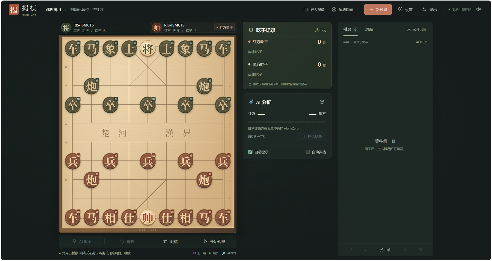
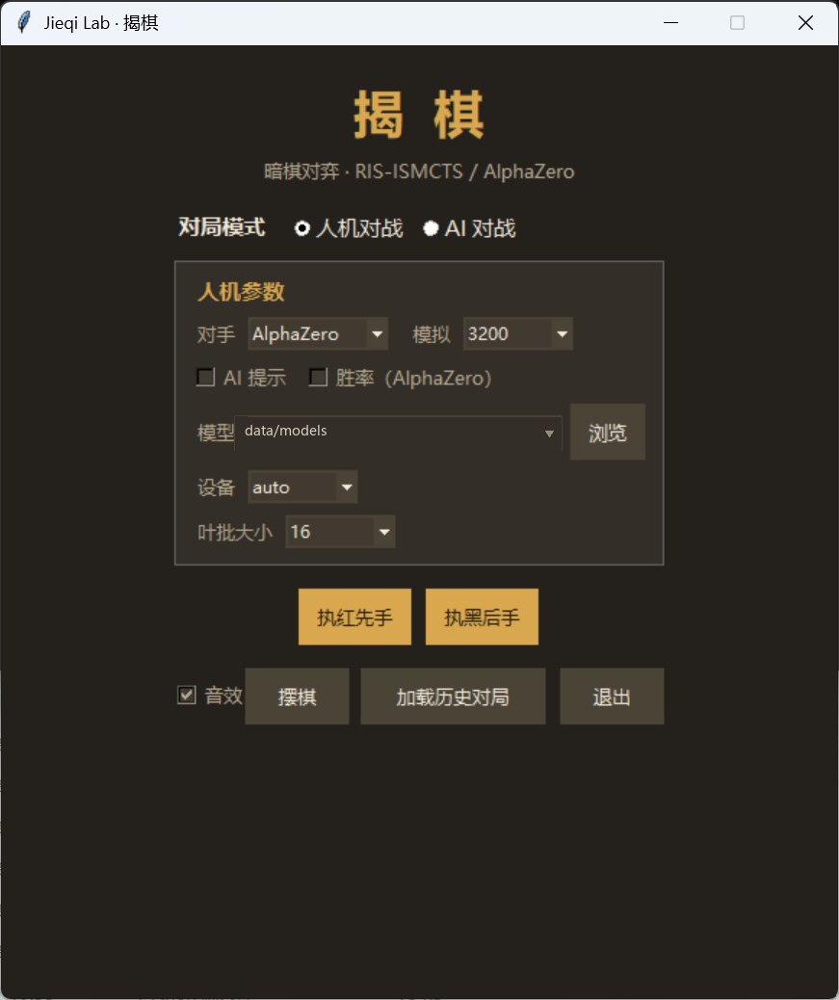

# Jieqi Lab · 揭棋 AI 与自博弈实验工具

[](LICENSE)
[](https://github.com/Yuan-Bai/jieqi-lab/actions/workflows/ci.yml)

> 以 MIT License 发布的揭棋 AI 实验工具：Python 规则引擎、RIS-ISMCTS、AlphaZero 风格训练、本地 Web 与 Tk GUI。模型、训练数据及原始实验材料不随仓库分发，历史数字不代表当前棋力。发布与验证流程见 [发布流程](docs/public-release-preparation.md)。

English: [README.en.md](README.en.md)

## 界面预览

网页版（本地标准库服务，棋盘 / 吃子 / 分析 / 棋谱三栏）：



桌面 GUI（Tkinter，人机与 AI 对战、回放与棋谱研究）：



揭棋（暗中国象棋）AI：Python 规则引擎 + RIS-ISMCTS 搜索 + AlphaZero 风格自博弈训练。

本项目参考天天象棋公开发布的揭棋规则进行独立实现（见 `docs/adr/0002`）；与腾讯及天天象棋无隶属、合作或背书关系。当前 `RULESET_VERSION = 5`，仍是项目近似裁判。长捉按公开移动追踪同一目标，双闪将不按格子排序指定锚点，见 [ADR-0020](docs/adr/0020-algorithm-audit-followup.md)。

> 先读[当前状态与下一步](docs/status.md)和[当前研究总览](docs/research-status.md)；[进度记录](docs/progress.md)保留实现演变和历史实验。

本仓库包含独立运行的规则、搜索、训练、对弈与复盘工具；网页对弈使用根目录的 `search_engine.py`。训练数据、模型权重和历史实验产物不随 Git 仓库分发。

## 环境

- Python 3.11+；规则、RIS 搜索和本地网页只用标准库，可直接运行 `python web_server.py`。
- 桌面 GUI 另需 Tkinter。已有本机验证来自 Windows；Linux/Windows CPU CI 与 Linux 原生后端见 [工作流](.github/workflows/ci.yml)。
- 神经网络功能需要 NumPy 和 PyTorch **2.10+**；CUDA GPU 用于较大的训练与批量评估。
  完整测试和诊断依赖也列在下面的安装文件中：

```powershell
python -m pip install -r requirements.txt
```

仅加载自己生成或可信来源的模型和 Pickle 数据；版本检查与 `weights_only=True`
不使任意外部文件变安全。详见 [安全说明](SECURITY.md)。

## English summary

Jieqi Lab is an experimental toolkit for Jieqi (Chinese chess with hidden pieces): a Python rules
engine, RIS-ISMCTS search, AlphaZero-style self-play, a local browser UI, and a Tkinter replay editor.
Run `python web_server.py` and visit `http://127.0.0.1:8765` for a standard-library-only RIS game.
Neural features require NumPy, PyTorch 2.10+, and trusted weights supplied by the user.

The rules are an independent approximation, not an official implementation or certification.
No pretrained models, training datasets, or raw historical experiments are distributed. Historical
performance figures are not current strength guarantees. Released under the [MIT License](LICENSE).
See [contributing](CONTRIBUTING.md), [security](SECURITY.md), [asset/dependency sources](THIRD_PARTY_NOTICES.md),
[synthetic replay examples](examples/README.md), and [release notes](CHANGELOG.md).

## 加速配置

当前加速状态、构建方法、回退开关与实测证据统一见 [加速配置](docs/performance.md)。
训练代码默认使用精确编码/批次预分配、策略输出数组和批内历史复用，不改变现有搜索预算。

| 配置 | 默认行为 |
|---|---|
| 攻击判定 `JIEQI_RULES_BACKEND` | `auto`：有效 Cython 扩展自动启用，否则 Python |
| 合法着 `JIEQI_LEGAL_BACKEND` | `python`：已验证快路可显式选择 `cython` |
| 节点 `JIEQI_SEARCH_BACKEND` | `python`：编译扩展只保留实验选项，初始化不启用 |
| 机会对象分配 | on/k=0 默认按需分配；`--no-lazy-chance-allocation` 恢复全量预建 |

现有 v5 完整检查点和 replay 可续用，无需重训或清空缓冲。新默认值只在重新启动后生效。
编译后端在导入时选择并校验二进制身份，不在训练启动时自动构建。
集中 GPU 推理、跨请求合批与跨批次网络缓存仍是隔离实验，未接入生产。
日常/构建/验证/测量/历史工具分类见 [tools/README](tools/README.md)。

## 快速开始

### 网页版对弈

```powershell
python web_server.py
```

打开 [http://127.0.0.1:8765](http://127.0.0.1:8765)：支持人机对弈（RIS-ISMCTS / 本机 AlphaZero 模型）、
同屏双人、AI 观棋、走子提示、悔棋、分支复盘、GUI 棋谱导入导出与合成音效，适配手机和桌面。
宽屏采用棋盘、吃子与分析、独立棋谱三栏；吃子逐枚按顺序常驻，上一着、AI 推荐与合法落点分色。
顶部提供导入、指南、音量与显示选项，应用后的参数和音量自动保存在当前浏览器；胜率更新时保留并标明旧结果。
纯搜索模式只需要 Python 标准库，无需前端构建。对局保存在服务进程中，刷新可继续，停止服务后不保留。
无需模型即可导入 [合成分支棋谱](examples/synthetic-branches.json)，体验翻子、吃子与分支复盘。
默认仅本机访问，GET/POST 都校验可信 Host/Origin；此服务不提供公网认证或远程房间。
详见 [网页版说明与 API](docs/web.md)。

### Python GUI

```powershell
# Tkinter GUI：人机对战 / AI 对战（人类视角不泄漏暗子信息，AI 对战为上帝视角）
# - 人机对战：执红或执黑，对手可选 RIS-ISMCTS（纯搜索）或 AlphaZero（加载 data/models 下的模型）
#   人机模式默认玩家在下方（执黑自动翻转棋盘），可随时点「翻转棋盘」切换视角
# - AI 提示：可在对局/回放中开关，AlphaZero 默认 200 模拟；无模型时可用 RIS 提示
# - 胜率显示：勾选后显示 AlphaZero 搜索根节点价值换算的红/黑胜率与比例条（人机 / AI 对战均实时计算）
# - AZ 叶批大小：默认 64；开局可设置，局中点「对弈叶批量」修改；「分析设置」独立控制提示/胜率叶批
# - 上帝视角：AI 对战参数中的开关；关闭后以观众视角隐藏暗盒组成与被吃暗子类型
# - 被吃棋子：人机模式按「我方 / 对方」显示，对方吃掉的暗子只显示 [暗]（终局才公开）
# - AI 对战：红黑双方各自选择 RIS-ISMCTS / AlphaZero，自动对弈，可暂停、调速
# - 上一步：棋盘标注起点（红虚线）/终点（金框 + 箭头），面板同步文字记谱
# - 棋谱研究：回放中走子创建变例，分叉处选择编号；保存全部分支与起始局面
# - 摆棋：配置明子、暗子假类型和真实暗池；可从研究局面继续人机 / AI 对战
# - 音效：首次运行自动生成到 assets/sounds/，可直接替换同名 WAV
python gui.py

# 全部测试
python -m pytest -q
```

## 对局记录、回放与摆棋

- 「保存对局」在对局和回放中均可用，保存**整棵棋谱树**及起始局面，默认目录 `data/replays/`。
  即使停在中间一步保存，也不会丢失后续走子或其他分支。
- 「回放本局」或点击棋谱中的历史走子进入研究模式，停止自动对弈并保留现有记录；主菜单可加载历史 JSON。
- 回放时可直接走子添加变例。已有相同走法会进入原分支并复用它的揭示结果；不同走法创建新分支。
  原历史保留，暗子揭示结果逐边记录，重放不会重新随机翻子。未固定身份的暗子在新变例中独立抽样，
  因而不同分支可能翻出不同棋子，不能直接当作同一副固定暗子布局的走法对照。
- 无分叉时「下一步」正常前进；有分叉时只显示棋盘箭头/阿拉伯数字及「下一步选项」，点击数字后才走子。
  可点击棋盘数字、编号按钮或按 1～9 选择。← → 返回父节点/查看下一步；「结尾」遇到分叉也会停下等待选择。
- 右侧可随时切换提示/胜率及分析模型、模拟次数、叶批大小、设备。按行动方信息分析，结果按节点、模型和搜索配置缓存；
  快速翻页或落子会取消过时分析。胜率为 `(value+1)/2` 并折半计算和棋，属于模型估计。
  上帝视角仅改变界面显示，分析仍使用行动方已知信息。
- AZ 对弈叶批默认 64，开局可选，局中用「对弈叶批量」调整，双方可独立设置；应用时取消旧搜索并按当前局面重算。
  同模型无需重载，分析叶批单独设置；叶批不超过模拟次数，与训练批量无关，较小批量可能增加搜索耗时。
- 「摆棋」支持明子、暗子假类型、先走方及双方真实暗池组成；每方暗池合计必须等于棋盘暗子数。
  「应用为新棋谱」后可手动研究，或用右侧「从此对弈」继续人机/AI 对战。离开未保存棋谱时会询问保存。
- 新格式 `format="jieqi-replay"`、`version=2`，继续读取 v1 线性棋谱；旧 GUI 无法读取 v2。
  GUI 可加载规则 v3/v4 棋谱，按当前 v5 逐步校验，显示来源版本；保存保留迁移信息，原文件不会自动改写。
  不符合当前规则的走子、缺失揭示或未知规则版本会拒绝加载；保存使用临时文件原子替换。
  详细设计及验证见 [GUI 说明](docs/gui.md)。

## 界面素材与音效

GUI 的棋盘与棋子由 Canvas 程序化绘制（无需图片素材）；音效为程序生成的 WAV，位于 `assets/sounds/`。
如需替换素材：
- 棋盘/棋子图片：[OpenGameArt](https://opengameart.org)、[Kenney](https://kenney.nl/assets)、[itch.io](https://itch.io/game-assets)
- 音效：[Kenney 音效包](https://kenney.nl/assets)（CC0 为主）、[Freesound](https://freesound.org)、[Pixabay Sounds](https://pixabay.com/sound-effects/)
自定义音效保持文件名不变即可：`select / move / capture / check / win / lose / draw.wav`。

## 训练（AlphaZero 自博弈）

以下是手动训练入口，会使用较大的默认配置；首次网页体验和日常使用无需运行。
先用 `python azero.py --help` 查看参数，并为实验准备独立目录。

```powershell
python azero.py
```

- 数据目录：`data/models`（`training_checkpoint.pt` / `latest.pt` / `best.pt` / `train_state.json`）、`data/selfplay`（gzip pickle 自博弈数据）、`data/eval`（评估 JSONL）、`data/logs`
- 评估与晋升分离：默认只报告，已有 `best.pt`/`best_score` 保留为旧 RIS 选择记录；新目录可能没有 best。准备自己的[冻结池清单](configs/README.md)后，在原续训命令追加 `--eval-pool data/eval/my_pool.json --eval-games 100 --eval-mcts-simulations 1600 --eval-leaf-batch-size 16 --eval-interval 5`，每次池中每个历史对手各100局。双方统一1600模拟/叶批16，池不会自动更新；未指定池时仍跑RIS回归，指定清单缺失或不匹配则报错。只有显式 `--legacy-ris-best` 恢复旧晋升行为，不能与池合用。选择/更新流程及配置见 [评估文档](docs/evaluation.md)。
- 完整续训优先 `training_checkpoint.pt`：原子保存模型、AdamW、调度器、轮计数、RNG 与缓冲文件清单；只读已提交数据，并保持每局增强顺序。`latest.pt`/`best.pt` 仍为 GUI/评估使用的纯权重。旧权重可兼容续训，但旧动量/RNG 无法补回；完整检查点损坏或其引用数据缺失时明确报错。迁移机器须同时保留引用的自博弈文件，见 [ADR-0015](docs/adr/0015-complete-training-checkpoint.md)。
- 改变 LR/调度或 cosine 总轮数时，用 `--reset-optimizer` 显式重建 AdamW/调度；模型、计数、缓冲、RNG 保留。只增大缓冲容量可在原续训命令中设置 `--replay-buffer-size 5000000 --allow-buffer-growth`，原目录、AdamW/调度、计数、RNG 和固定诊断保持；精确恢复原 FIFO 后由后续新数据填满，不扫描回填更旧数据。扩容会在生成新对局前提交新容量与裁剪边界；后续续训保留新容量，允许省略扩容开关。该开关要求已有完整检查点，只允许扩容；缩容或改变增强仍需新目录热启动。普通完整续训重用原配置，扩容本身不需要 `--reset-optimizer`。
- `--run-iterations N` 限制本次新增轮数，保持原 `--iterations` 的cosine总计划。`--diagnostic-games 32` 从下一轮新对局一次性按整局留出，增强前排除；固定训练参照/留出每轮记录KL、value误差与校准，随完整检查点自动恢复。已有五轮数据不追认为留出，历史设计见 [固定诊断说明](docs/reviews/2026-10-02-fixed-diagnostics.md)。自己完成训练后可只读核对：`python tools/diagnose_training.py --data-dir data --checkpoint data/models/training_checkpoint.pt`；仓库不附该检查点。
- Windows训练CLI在torch导入前设置worker信号，并用本次训练的Job处理Ctrl+C/Ctrl+Break，覆盖spawn启动时的管道阻塞；中断后从最近完整检查点继续，原命令有效。原生退出可能直接返回终端。设计与验证见 [ADR-0017](docs/adr/0017-windows-training-interrupt.md)。
- 每次运行自动生成 `data/runs/<run_id>/manifest.json`：完整配置、架构/版本、代码内容哈希（含未提交源文件）、父模型与检查点哈希。新自博弈/训练评估带 run/attempt 来源，提交状态以完整检查点及提交记录为依据；旧历史来源不补造。只读查看：`python tools/run_status.py --data-dir data`，见 [ADR-0016](docs/adr/0016-run-provenance.md)。迁移时同时保留 `runs/` 和评估文件。
- 无完整检查点时的兼容加载：默认（`--max-load-files 0`）按 `--replay-buffer-size` 从最新文件回填；`--max-load-files N` 只加载最近 N 个文件，可能与连续训练不一致，仅用于历史配置。完整续训按保存清单恢复，不受目录中未提交文件或此加载上限影响。
- 训练回填会跳过 `ruleset_version` 不匹配的数据；旧规则训练归档未分发。纯权重 `.pt` 不含规则/搜索版本，加载时需核对来源；完整检查点另有版本元数据。
- 当前 `RULESET_VERSION=5, SEARCH_VERSION=3`：旧规则完整检查点与续训状态被明确拒绝，旧自博弈数据不会回填当前缓冲；可信的旧纯网络权重可作新目录热启动的父权重。历史训练目录未分发；不要按旧报告路径假定已有可续训模型。旧 GUI 棋谱兼容路径见上文。根噪声按合法归一化后混合；策略裁剪有界且保留最高访问着法，不承诺精确消除噪声。
- 关键超参见 `AZConfig`（自博弈默认：800 模拟、15 残差块、批量叶评估 `leaf_batch_size=64`、虚拟损失 3.0、固定 `train_steps=1000` 步/轮，见 ADR-0010；评估单独默认1600模拟/叶批16）
- 训练、GUI 与评估默认 `chance_nodes=True, chance_k=0`（完整揭示支持、对象按需分配，按当前模拟世界概率采样）。训练用 `--no-lazy-chance-allocation` 恢复全量预建，不改变采样支持。`--no-chance-nodes` 按实际公开翻子结果惰性建树，避免不同公开局面复用固定动作集合（Issue 0007）。环境结果按行动者可见信息连接共享决策节点；合成对手知道粒子中它吃过什么，不知道自己被吃类型，见 `docs/adr/0012-search-information-sets.md`。仍采用计数信念与根采样近似。
- 数据增强：左右镜像（`--no-augment-mirror` 关闭）与楚河汉界翻面+红黑互换+暗池互换（`--no-augment-flip` 关闭）默认都开，每个样本共 4 份（完整棋盘+颜色对称群），见 `docs/adr/0011`
- 当前编码 238 通道、`DATA_VERSION=3`：补全将军锚点、长捉目标码与仍可能重复的公开历史。旧 64/71 通道模型新增输入权重自动补零；v2 数据可继续加载，缺失历史明确标记，v1 仍拒绝。输入与缓冲内存增加，设计、成本及验证见 `docs/adr/0013-rule-history-encoding.md`。
- `--chance-k K` 只限制每层初始预建数量；始终从完整模拟世界暗池抽取结果，遗漏分支按需补建，节点可以超过 K。默认 0 保留完整支持并按需分配对象，K>0 不启用此对象分配优化；显式 `--lazy-chance-allocation` 与 K>0/off 组合报错，见 [ADR-0014](docs/adr/0014-lazy-chance-support.md)。旧 k4 对比不能当作新实现的收益。

## 评估

仓库不附模型、历史评估原始数据或外部引擎。以下命令需要自行准备可信模型；
历史池用法先见[清单说明](configs/README.md)，示例中的 `my_pool.json` 由使用者创建。

```powershell
# RIS 回归：50 局 @400 sims；不用于确认当前模型超过历史模型
python tools/eval.py --model data/models/latest.pt --quick

# 日常历史池：双方1600模拟/叶批16，每个对手100局，分别报告
python tools/eval.py --model data/models/latest.pt --pool data/eval/my_pool.json --games 100 --sims 1600 --leaf-batch-size 16 --seed 2026102202
```

2026-10-22实测：完成62轮的模型对三个历史模型得分52%/49.5%/58%，配对区间均包含50%；
对Pika 1万/10万节点小样本得分15%/5%。RIS-800的95%–98%不足以证明超过历史模型。
结果与限制见 [340局报告](docs/reviews/2026-10-22-opponent-pool-evaluation.md)。
该报告为旧800模拟/叶批64基准，新的1600/16尚未重跑完整棋力评估，结果不能直接拼接。
结果写入 JSONL，优先整对 bootstrap 95% 区间，退化样本显式提示；旧Wilson字段仅兼容。
历史池哈希校验、Pika可执行文件/参数和正式验收边界见 [评估说明](docs/evaluation.md)。
独立评估记录双方模型来源、代码/配置、逐局 run ID，完成后保存输出哈希。默认生成新文件；指定 `--out` 已存在时拒绝覆盖。对应运行记录位于输出目录的 `runs/`，可用 `python tools/run_status.py --data-dir data/eval` 查看。
模型对手默认继承己方机会节点配置；可用 `--opponent-chance-nodes on/off` 与 `--opponent-chance-k` 显式覆盖。
2026-10-01 搜索修复改变了 off/RIS 的树语义，评估默认值也改为开启；旧 A/B 配置已显式固定开关，但新结果不能视为旧搜索的逐位复现。本次没有据历史对比判断棋力收益。

## 性能基准

```powershell
python tools/bench.py --games 1 --sims 200 --workers 8 --batch 64
```

短时训练资源与学习信号探针（会运行隔离短训，仅在明确需要实验时手动执行）：
`python tools/probe_training_budget.py --data <自己生成的可信样本.pkl.gz>`。
原 batch 资源测试与小规模新数据短训分开；不代表完整 4M/8-worker 峰值或棋力提升，详见 `docs/reviews/2026-10-01-training-budget.md`。

Stage 1 历史测量（RTX 4060 Laptop，未训练网络、早期搜索版本）：单进程 batch=1 约 326 evals/s；8 workers × batch 64 约 7500–8200 evals/s（对旧 8-worker 日志推算约 3–4×，对单进程约 23×）。这些数值不代表当前搜索与编码的吞吐；当前短测及限制见上述训练预算报告。

## 规则要点（项目近似裁判）

- 暗子按假类型行棋，走子后自动翻开；暗士限九宫，暗象**受河界限制**；明士/象无区域限制
- 己方暗子被吃后看不到类型（吃方得知）；GUI 人类视角按此过滤
- 长将/长捉：连续 6 回合后继续该行为属禁着，无替代着法判负
- 长捉新目标：最高价值目标唯一才开始计数；并列时清空追击。已有目标按公开移动更新位置/棋子码，不用同类型棋子猜身份（v5）
- 长将锚点：优先延续旧将军子或选择移动后将军的棋子；双闪将无唯一棋子时仅记一次将军，不指定锚点
- 重复局面（轮次+棋盘，不含暗池）第 3 次判和；无吃子 80 ply 判和
- 将死/困毙判负；判定顺序：将死优先于长将（已修复）

## 项目结构

```
jieqi.py         规则引擎（GameState / 合法性 / 判定 / FEN）
ismcts.py        RIS-ISMCTS 与信念模型（BeliefModel）
azero.py         AlphaZero 训练（网络 / MCTS / 自博弈 / 数据）
search_engine.py 通用搜索引擎封装（网页对弈 / 分析 / 性能探针）
gui.py           Tkinter 界面（人机 / AI 对战、翻转棋盘、AI 提示、胜率、音效、对局保存/回放）
pika_engine.py   Pikafish jieqi_old 信息态/UCI桥接（独立挑战）
tools/eval.py    配对评估协议（冻结模型池 / 配对 bootstrap / JSONL）
configs/        冻结评估对手清单（权重另存于 data/）
tools/bench.py   吞吐基准
merge_selfplay.py  自博弈数据合并工具
tools/README.md 工具分类（日常 / 构建 / 验证 / 测量 / 隔离原型 / 历史）
docs/            文档索引（README.md）、当前状态、加速索引（performance.md）、研究、ADR、审查与历史进度
CONTEXT.md       领域术语表
```

## 路线图

- 已完成：搜索/信息边界/编码修复、完整检查点、来源记录、固定整局诊断与精确加速验收；机会节点完整支持和对象按需分配默认开启。测试与性能证据见 [当前状态](docs/status.md)、[加速配置](docs/performance.md)。
- 发布状态（2026-10-23）：首个公开版本 0.1.0，MIT License；CI 覆盖 Linux/Windows CPU 与 Linux 原生后端；模型与训练数据不随仓库分发。流程见[发布流程](docs/public-release-preparation.md)。
- 评估功能：冻结历史池、Pika 独立挑战与配对统计已接入，训练默认只报告。2026-10-22 的历史训练快照完成 62 轮、63,968 局，尚未确认全面超越历史模型；模型和原始结果未分发，见[研究总览](docs/research-status.md)。
- 后续候选：根据新版本证据考虑性能优化、扩网、策略条件后验或教师蒸馏；历史 Gate 与 A/B 留在 `docs/progress.md`，不作为当前配置结论。

## 许可证

本项目以 [MIT License](LICENSE) 发布。第三方依赖与素材来源见 [THIRD_PARTY_NOTICES.md](THIRD_PARTY_NOTICES.md)。
